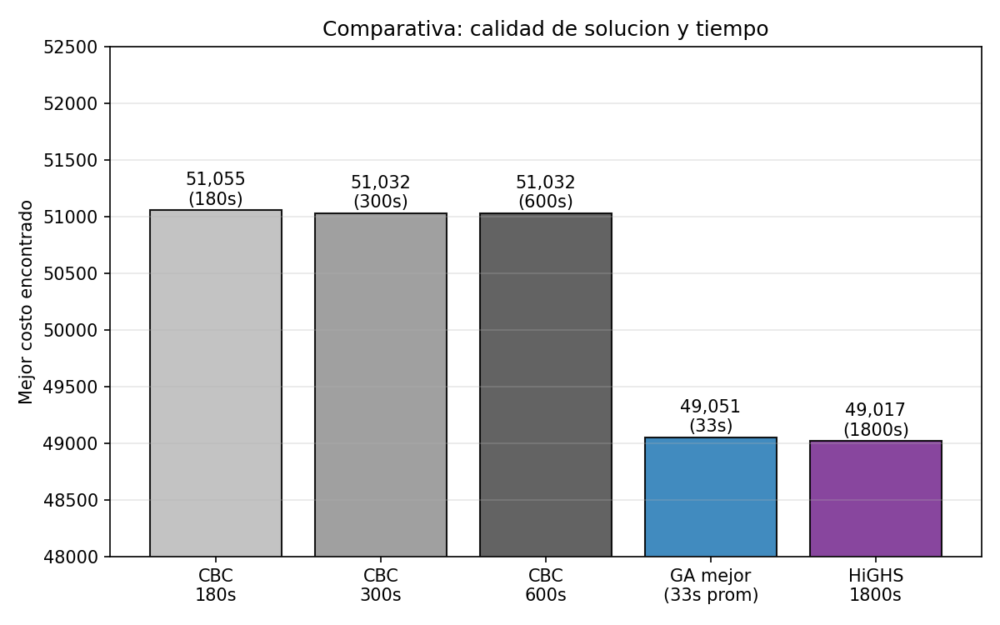
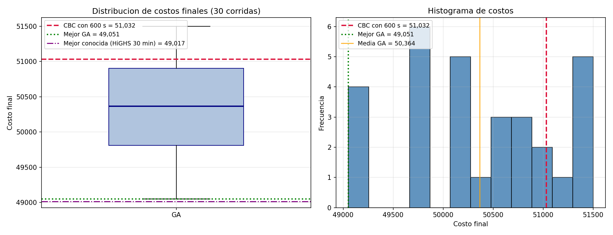

# Ubicación de antenas: programación entera vs algoritmo genético

Comparación entre dos formas de resolver un problema de cobertura de conjuntos (Set Cover) con 500 clientes y 500 antenas posibles: elegir qué antenas instalar para cubrir a todos los clientes al menor costo.

> **English summary:** Set Cover instance with 500 customers and 500 candidate antennas. I compared exact integer programming (CBC via PuLP, and HiGHS) against a genetic algorithm we implemented from scratch. Neither exact solver could prove optimality within the time limit; the GA's best run came within 0.07% of the best known solution in about 30 seconds, while CBC with 10 minutes stayed 4.1% above it.

**Curso:** Investigación de Operaciones I, UNAB, mayo de 2026
**Equipo:** Leydy Yohana Macareo Fuentes y Mariana Barragan
**Tecnologías:** Python, PuLP (CBC), SciPy (HiGHS), NumPy, pandas, Matplotlib



## Resultado principal

Ningún solver exacto logró probar el óptimo en el tiempo disponible: tras 30 minutos, HiGHS seguía con una brecha de 35% entre su mejor solución y su cota inferior. Por eso la comparación se hace contra la mejor solución conocida, que encontró HiGHS: **49.017**.

- **Algoritmo genético (mejor de 30 corridas):** 49.051, a 0,07% de la mejor conocida, en unos 30 segundos.
- **Algoritmo genético (promedio de 30 corridas):** 50.364, a 2,75%, con 33 segundos por corrida.
- **CBC con 10 minutos:** 51.032, a 4,1%.

Con un presupuesto de tiempo limitado, el algoritmo genético da soluciones casi tan buenas como un solver exacto con 30 minutos, en una fracción del tiempo. 24 de las 30 corridas superaron a CBC con 10 minutos.



## Modelo

Variables binarias `x_j` (1 si se instala la antena `j`). Se minimiza el costo total `Σ c_j · x_j` sujeto a que cada cliente `i` quede cubierto por al menos una antena: `Σ_j A_ij · x_j ≥ 1`.

## Métodos

**Exacto:** el modelo se resuelve con branch and cut en CBC (vía PuLP) con límites de 180, 300 y 600 segundos, y con HiGHS (vía SciPy) con 30 minutos. También se calcula la relajación lineal como cota inferior.

**Algoritmo genético** (`src/genetic_algorithm.py`), implementado desde cero:

- población inicial con una heurística voraz aleatorizada,
- selección por torneo, cruce uniforme, mutación por bit y elitismo,
- reparación de individuos: agrega antenas hasta cubrir a todos los clientes y luego quita las redundantes,
- parada temprana si no mejora en 80 generaciones.

Se corrió 30 veces con semillas distintas (42 a 71) para medir la variabilidad. Todas las soluciones se verificaron de forma independiente: cubren los 500 clientes.

## Una corrección sobre una versión anterior

Una primera versión del reporte concluía que el genético había superado a un óptimo "probado" por CBC. Era un error: PuLP reporta el estado `Optimal` aunque CBC se detenga por límite de tiempo con una solución factible. El código ahora solo acepta la optimalidad si el solver terminó antes del límite, y el reporte compara contra la mejor solución conocida.

## Estructura

```
data/              Instancia: matriz de cobertura (CSV) y costos por antena (XLSX)
src/
  utils.py                  Carga de datos y verificación de soluciones
  exact_solver.py           Relajación lineal y programación entera con CBC
  metodo_exacto_highs.py    Programación entera con HiGHS
  genetic_algorithm.py      Algoritmo genético
  experimentos.py           30 corridas del genético y gráficas
  generar_reporte.py        Reporte comparativo final
results_final/     Resultados publicados: reporte, tablas, gráficas y soluciones
results_highs/     Resultado de HiGHS
```

## Cómo ejecutarlo

```bash
pip install -r requirements.txt
cd src
python genetic_algorithm.py        # una corrida del genético (~30 s)
python exact_solver.py             # CBC con límite de 600 s
python metodo_exacto_highs.py      # HiGHS con límite de 30 min
python experimentos.py             # 30 corridas del genético
python generar_reporte.py          # reporte final a partir de results_final/
```

Los scripts de experimentos escriben en `results/`; los resultados publicados están en `results_final/` y `results_highs/`.
